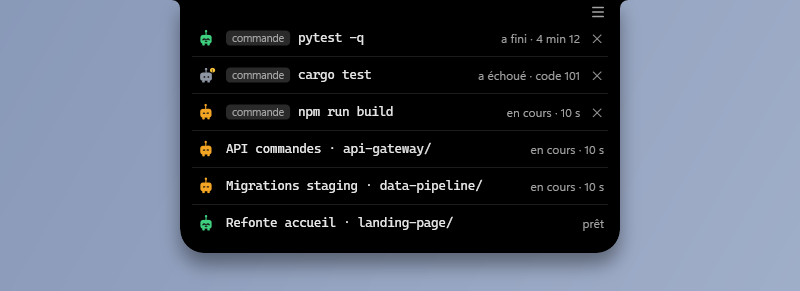
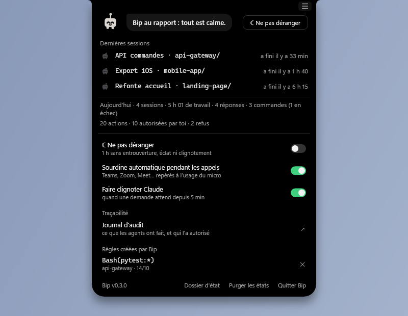
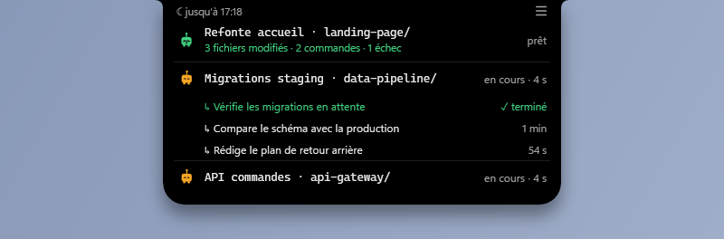
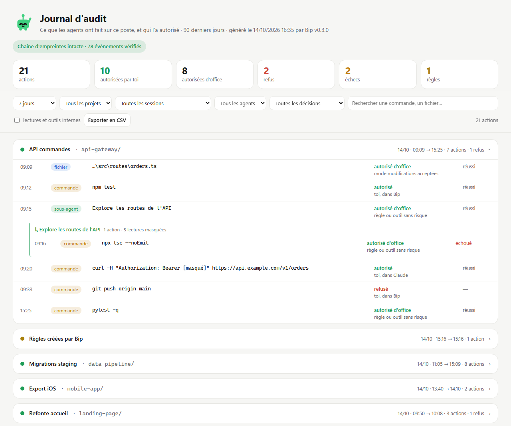
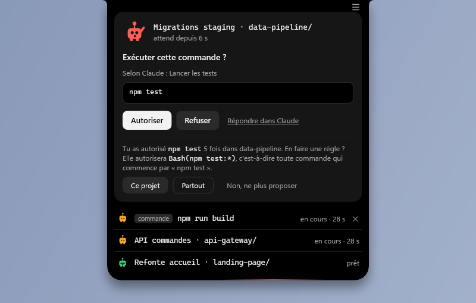
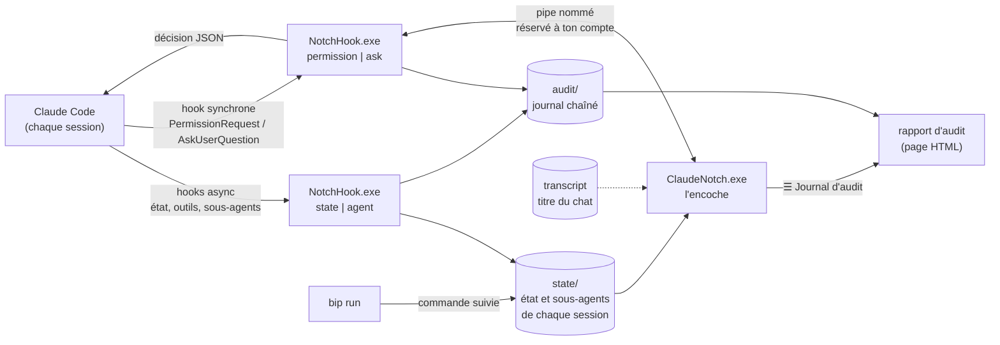
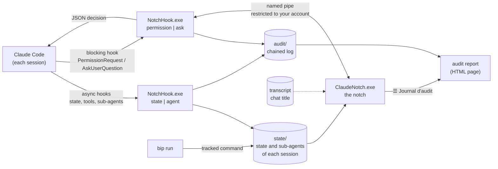

<div align="center">


# Bip

**L'encoche Claude Code pour Windows.**
Un petit robot par session, collé en haut de l'écran : tu vois d'un coup d'œil qui travaille,
qui a fini et qui t'attend, et tu réponds sans changer de fenêtre.


[](https://github.com/CR0ZER/bip/releases/latest)

**🇫🇷 Français** · [🇬🇧 English](#english)


</div>

---

## Pourquoi

Claude Code travaille seul pendant de longues minutes, souvent dans plusieurs sessions à la fois.
Le problème n'est pas de le lancer, c'est de **savoir quand il a besoin de toi** : une commande
à autoriser, une question à trancher. Tant que personne ne répond, la session est bloquée.

Bip vit dans une encoche noire en haut au centre de l'écran, façon *Dynamic Island*. Repliée,
elle se fait oublier et laisse passer les clics ; au survol, elle se déplie et te laisse
répondre directement.

## Pensé pour être léger

Bip tourne en permanence à côté de ton travail : il doit se faire oublier, sur n'importe quel PC.

- **Un seul processus permanent**, `ClaudeNotch.exe`. Le hook `NotchHook.exe` ne vit que le temps
  d'un appel, en arrière-plan, sans jamais ralentir Claude.
- **Aucune dépendance** : ni SDK, ni bibliothèque externe, ni accès réseau. Tout est compilé par
  le `csc.exe` livré avec Windows.
- **Un affichage sobre** : rendu logiciel, animations en boucle à 8 images/s encoche repliée
  (15 dépliée), éclat seulement quand quelqu'un attend, fenêtre à la taille de l'encoche, et rien
  ne s'anime une fois caché.
- **Un hook économe** : lecteur JSON maison (aucune bibliothèque .NET à charger), journal d'audit
  relu seulement pour ses nouvelles lignes, processus vérifiés directement plutôt qu'en listant
  tout le poste.

**Audit de performance avant chaque release.** Chaque version est mesurée avant d'être publiée :
consommation de l'encoche, mémoire, durée du hook comparée à la version précédente. Toute
régression est corrigée avant la sortie. En 0.3.0, cet audit a par exemple révélé que des
animations cachées doublaient la consommation après un dépliage : c'est corrigé.

**Mesures v0.3.0**, sur un PC portable Acer Nitro ANV15-52 : Intel Core i7-13620H (10 cœurs,
16 threads), 32 Go de RAM, Windows 11.

| Situation | Processeur | Mémoire |
|---|---|---|
| Une session au travail (Bip animé), y compris après des dépliages | ~2,3 % d'un cœur | ~76 Mo |
| Aucun Bip animé (mesuré en v0.2) | < 1 % d'un cœur | ~70 Mo |
| `NotchHook.exe`, par appel d'outil, journal d'audit et sous-agents compris | ~115 ms, en arrière-plan | — |
| Relecture du journal d'audit après un ajout, grosse journée (10 000 évènements) | ~15 ms | — |
| Rapport d'audit (1 200 évènements), généré en arrière-plan | ~0,8 s | — |

« % d'un cœur » : la part d'un seul cœur logique, soit 16 fois moins de la capacité totale de
ce processeur. La durée du hook est surtout celle du démarrage de .NET (~90 ms sur ce PC). Le
détail des mesures est dans [`docs/CONCEPTION.md`](docs/CONCEPTION.md).

## Aperçu

| Repliée | Une demande arrive |
|:---:|:---:|
|  |  |
| Un Bip par session ou commande suivie, dans l'ordre de lancement (5 au plus, puis « +N »). | L'encoche s'entrouvre 4 s pour dire qui attend (le titre du chat), puis se replie ; un éclat rouge balaie son bord tant que la demande est ouverte. |

| Répondre à une question | Encoche vide |
|:---:|:---:|
|  |  |
| Choix unique, choix multiple ou réponse libre (« Autre… »). | Plus rien ne tourne : Bip se réveille, salue, montre les dernières sessions et le bilan du jour. |

| Commandes suivies (`bip run`) | Réglages (☰) |
|:---:|:---:|
|  |  |
| En cours, finie ou en échec avec son code ; une croix les retire. | Le bouton ☰ ajoute les réglages sous le contenu de l'encoche. |

| Sous-agents et fin de tour |
|:---:|
|  |
| Sous chaque session, ses sous-agents en retrait ; en vert, le récap du tour d'une session prête. En haut à gauche, le « ne pas déranger » en cours. |

## Bip


| État | Quand | Ce qu'il fait |
|---|---|---|
| **En attente** (rouge) | Une permission ou une question attend ta réponse | Lève le bras, respire de plus en plus vite, tremble de temps en temps |
| **En cours** (orange) | Claude réfléchit, lit, exécute | Flotte doucement |
| **Prêt** (vert) | Claude a fini et rend la main | Fait un petit saut, puis s'efface au bout de 4 min |
| **Erreur** (gris, « ! ») | Le tour s'est arrêté sur une erreur de l'API | S'affaisse |
| **Au repos** (gris foncé) | Session ouverte, rien demandé encore | Dort, antenne pliée |

Chaque état se lit aussi sans la couleur (bras, pastille, antenne), même à 16 px.
Le kit complet (SVG, PNG, valeurs de référence, aperçu animé) est dans [`design/bip-mascotte`](design/bip-mascotte).

## Fonctionnalités

- **Suivi en direct** de toutes les sessions Claude Code du poste (app desktop, terminal, IDE),
  chacune sous le **titre de son chat Claude** suivi de son dossier : « Migrations staging ·
  data-pipeline/ ». Plusieurs sessions dans le même dossier se distinguent enfin.
- **Sous-agents visibles** : sous la session, chaque sous-agent qu'elle lance, avec sa
  description et sa durée (5 au plus, puis « +N »). Fini, il passe au vert une minute, puis
  disparaît, sans entrouvrir l'encoche. Repliée, l'encoche garde un seul Bip par session.
- **Récap de fin de tour** : quand une session rend la main, ce qu'elle a fait, en vert sous son
  nom : « 3 fichiers modifiés · 2 commandes · 1 échec ».
- **Permissions depuis l'encoche** : Autoriser, Refuser, ou « Toujours » avec la portée écrite
  sur le bouton (« Toujours : toutes les modifications de fichiers », « Toujours : Edit(src/\*\*) »…),
  limitée à la session. Jamais de « Toujours » pour les commandes shell.
- **Questions (AskUserQuestion)** : choix unique, multiple, plusieurs questions, réponse libre.
- **Répondre dans Claude** à tout moment : la demande repart dans la fenêtre habituelle.
- **Encoche vide** : Bip salue (et réagit si tu cliques dessus), dernières sessions terminées,
  bilan du jour (sessions, temps de travail, réponses). Un clic ailleurs ouvre Claude.
- **Ne pas déranger** pendant 1 h : ni entrouverture, ni éclat, ni clignotement. Rappelé en haut
  à gauche de l'encoche dépliée (« ☾ jusqu'à 17:18 », « ☾ appel en cours (Teams) ») ; un clic
  le lève.
- **Sourdine automatique pendant les appels** (Teams, Zoom, Meet, Slack, Discord, Webex…) :
  Bip le signale d'un bref « ☾ Ne pas déranger · appel en cours », puis te dit à la fin de
  l'appel ce qui s'est passé (« 2 sessions ont fini · data-pipeline t'attend depuis 12 min »).
  Détectée par l'utilisation du micro, aucune intégration à installer ; désactivable.
- **Escalade douce** : après 5 min d'attente, la fenêtre Claude clignote dans la barre des
  tâches (désactivable). Jamais de mise au premier plan forcée, aucun son.
- **Invisible quand il le faut** : masquée pendant les applis en plein écran.
- **Réglages dans l'encoche** : le bouton **☰** en haut à droite de l'encoche dépliée (ou un
  clic droit) ajoute les réglages sous le contenu : ne pas déranger, sourdine pendant les
  appels, clignotement, journal d'audit, règles créées par Bip, dossier d'état, quitter.

### Suivre une commande longue : `bip run`

```bat
bip run npm run build
```

La commande tourne dans ton terminal, sortie et couleurs intactes, et apparaît dans l'encoche
avec sa durée. À la fin, Bip s'entrouvre (« npm run build a fini · 4 min 12 s », ou en échec
avec le code de retour). `bip` renvoie le code de la commande : il s'utilise dans un script.
Une petite croix retire une commande de l'encoche (si elle tourne encore, elle continue).

### Journal d'audit

Bip garde la trace de **tout ce que les agents font sur le poste** : chaque commande, fichier
modifié ou page consultée, qui l'a autorisé (toi dans Bip, toi dans Claude, une règle, le mode
auto) et le résultat.

- **Secrets masqués avant écriture** (jetons, clés d'API, mots de passe, identifiants dans les
  adresses).
- **Chaîne d'empreintes SHA-256** : une ligne modifiée ou supprimée après coup, ou une fin de
  journal tronquée, se voit. `ClaudeNotch.exe --verify-audit` la contrôle.
- **Rapport** depuis les réglages de l'encoche (☰ → « Journal d'audit ») : une page autonome,
  claire ou sombre, **regroupée par session** (titre du chat) **puis par agent** : sous chaque
  sous-agent, ses propres actions. Synthèse en tête, filtres par période, projet, session,
  agent, décision et texte, export CSV.
- Conservé 90 jours, sur le poste uniquement.



### Règles suggérées

Après **5 autorisations de la même commande dans un projet** (`npm test`, `pytest`…), Bip
propose d'en faire une règle Claude Code, en affichant la règle exacte : **Ce projet** (écrite
dans `.claude/settings.local.json`, non versionné), **Partout**, ou **Non, ne plus proposer**.
Jamais de suggestion pour une commande composée, risquée (suppression, `git push`, réseau,
interpréteur…) ou trop large. Les règles créées se retirent d'un clic depuis les réglages (☰), et chaque
ajout ou retrait est inscrit au journal d'audit.

<p align="center"></p>

## Installation

Prérequis : Windows 10 ou 11 (le .NET Framework 4.x est déjà présent) et Claude Code.
Répondre aux questions depuis l'encoche demande Claude Code 2.1.85 ou plus récent.

**Télécharger** (le plus simple) : prends `Bip-vX.Y.Z.zip` dans la
[dernière release](https://github.com/CR0ZER/bip/releases/latest), décompresse-le dans un dossier
permanent (par exemple `Documents\Bip`, pas dans Téléchargements : les hooks pointent vers ce
dossier), puis lance `installer.cmd`.

> Les exécutables ne sont pas signés : au premier lancement, Windows SmartScreen peut afficher
> « Windows a protégé votre ordinateur ». Clique sur *Informations complémentaires* →
> *Exécuter quand même*. L'empreinte SHA-256 du zip est publiée avec chaque release, et tu
> peux toujours compiler toi-même.

**Depuis les sources** (compilé sur ton poste, sans rien installer) :

```bat
git clone https://github.com/CR0ZER/bip.git
cd bip
installer.cmd
```

`installer.cmd` compile les exécutables si besoin, ajoute les hooks de Bip dans
`~/.claude/settings.json` (une sauvegarde datée est faite à côté), ajoute le dossier de Bip à
ton `PATH` (pour `bip run`), ajoute l'encoche au démarrage de Windows et la lance. Il peut être relancé sans risque.

**Mettre à jour** : remplace le contenu du dossier par la nouvelle version, puis relance
`installer.cmd`. Il ajoute les hooks apparus entre-temps (en 0.3.0 : `SubagentStart` et
`SubagentStop`, pour les sous-agents) ; ton journal d'audit et tes réglages sont conservés.

Pour tout retirer : `desinstaller.cmd`, puis supprimer le dossier. Seules les entrées de Bip
sont retirées de `settings.json` ; tes autres hooks ne sont pas touchés.

> Les nouvelles sessions Claude prennent les hooks en compte immédiatement ; une session déjà
> ouverte peut demander un redémarrage.

## Comment ça marche



- **L'état des sessions** passe par des hooks asynchrones : ils ne ralentissent jamais Claude.
  `NotchHook.exe` écrit l'état, le dossier, le pid et le transcript (d'où vient le titre du chat)
  dans `state\`, et les sous-agents dans un fichier à côté ; l'encoche relit ces fichiers.
- **Les réponses** passent par des hooks synchrones : le hook transmet la demande à l'encoche
  par un pipe nommé, attend ton clic, puis renvoie la décision à Claude Code.
- **Le journal d'audit** est écrit par le hook lui-même, à chaque outil, demande et décision :
  il est tenu même encoche fermée. L'encoche en tire le rapport à la demande.
- **`bip run`** écrit son propre fichier d'état dans `state\` : une commande suivie apparaît
  comme une session.
- **Tout est compilé par le `csc.exe` livré avec Windows**, sans SDK : `build.cmd` suffit.

## Sécurité

- **Échec sûr** : encoche fermée, plantée ou injoignable, délai dépassé, demande illisible →
  le hook ne répond rien et Claude pose la question lui-même. **Jamais d'autorisation implicite.**
- **Pipe réservé** au compte Windows courant ; le hook vérifie que le serveur est bien le
  `ClaudeNotch.exe` installé à côté de lui avant d'envoyer quoi que ce soit.
- **Rien ne se valide au survol** : un clic complet est nécessaire, et les boutons ne s'arment
  qu'après 600 ms (ouverture, nouvelle carte ou liste qui bouge).
- **Ce que tu lis est ce qui sera exécuté** : commande toujours affichée en entier (avec le
  nombre de lignes si elle est longue), caractères invisibles ou d'inversion (U+202E…) rendus
  visibles, description de Claude présentée comme telle (« Selon Claude : … »).

## Structure

```
src/
  App.cs          point d'entrée, installation / désinstallation, appels Windows
  NotchWindow.cs  l'encoche : formes, transformations, cartes, encoche vide
  Bip.cs          la mascotte (portage C# du contrôle WPF du kit)
  Model.cs        sessions, journal du jour, demandes en attente, pipe nommé
  NotchHook.cs    le hook appelé par Claude Code
  Agents.cs       sous-agents et titre des sessions
  BipCli.cs       bip.exe : bip run <commande>
  Audit.cs        journal d'audit : écriture chaînée, masquage, lecture
  Rules.cs        règles suggérées
  Report.cs       rapport d'audit HTML
  Json.cs         lecture / écriture JSON
  Version.cs      numéro de version (vérifié par la release)
tests/                 tests du journal d'audit (lancés aussi par la release)
design/bip-mascotte/   kit de la mascotte (SVG, PNG, tokens.json, aperçu animé)
docs/                  journal de conception et captures
.github/workflows/     release automatique à chaque tag vX.Y.Z
build.cmd · installer.cmd · desinstaller.cmd · CHANGELOG.md
```

**Diagnostic** : `ClaudeNotch.exe --dump-plan` affiche les sessions lues (titre, dossier,
sous-agents) et ce que l'encoche montrerait ; `notch.log` recueille les erreurs ; `journal\` garde 7 jours de bilan.

## Crédits

- **Inspiré de [coucou](https://github.com/Louis-CFM/coucou)** de Louis-CFM, l'encoche compagnon
  pour agents de code sur macOS (licence MIT). Bip en reprend l'idée (un bloc noir qui se
  transforme, des réponses depuis l'encoche) ; le code, la mascotte et le design sont propres
  à ce projet.
- **Mascotte et design** conçus avec Claude Design.
- Projet indépendant, non affilié à Anthropic. « Claude » et « Claude Code » sont des marques
  d'Anthropic.

## Licence

[MIT](LICENSE) © 2026 CR0ZER

<br>

---

<br>

## English

[🇫🇷 Version française ↑](#bip) · **🇬🇧 English**

**The Claude Code notch for Windows.** One little robot per session, docked at the top of your
screen: see at a glance who is working, who is done and who is waiting for you, and answer
without switching windows. *The interface is in French.*

### Why

Claude Code works on its own for long minutes, often in several sessions at once. Starting it
is easy; the hard part is **knowing when it needs you**: a command to approve, a question to
answer. Until someone replies, the session is stuck.

Bip lives in a black notch at the top centre of the screen, *Dynamic Island* style. Collapsed,
it stays out of the way and lets clicks through; hover it and it unfolds so you can answer
right there.

### Built to stay light

Bip runs all day next to your work: it has to go unnoticed, on any PC.

- **A single long-running process**, `ClaudeNotch.exe`. The `NotchHook.exe` hook only lives for
  one call, in the background, and never slows Claude down.
- **No dependencies**: no SDK, no external library, no network access. Everything is built with
  the `csc.exe` that ships with Windows.
- **A frugal display**: software rendering, looping animations at 8 fps in the collapsed notch
  (15 when open), glow only while someone is waiting, a window sized to the notch, and nothing
  keeps animating once hidden.
- **A thrifty hook**: built-in JSON reader (no .NET library to load), audit log re-read only for
  its new lines, processes checked directly instead of listing the whole machine.

**Performance audit before every release.** Each version is measured before it ships: notch CPU
and memory, hook duration compared with the previous version. Any regression is fixed before the
release. In 0.3.0, for instance, this audit found that hidden animations doubled the CPU use after
opening the notch: fixed.

**v0.3.0 measurements**, on an Acer Nitro ANV15-52 laptop: Intel Core i7-13620H (10 cores,
16 threads), 32 GB RAM, Windows 11.

| Situation | CPU | Memory |
|---|---|---|
| One session working (Bip animated), including after opening the notch | ~2.3 % of one core | ~76 MB |
| No animated Bip (measured in v0.2) | < 1 % of one core | ~70 MB |
| `NotchHook.exe`, per tool call, audit log and sub-agents included | ~115 ms, in the background | — |
| Re-reading the audit log after a new line, busy day (10,000 events) | ~15 ms | — |
| Audit report (1,200 events), built in the background | ~0.8 s | — |

"% of one core": the share of a single logical core, i.e. 16 times less than this CPU's total
capacity. Most of the hook's time is .NET start-up (~90 ms on this PC). Measurement details are
in [`docs/CONCEPTION.md`](docs/CONCEPTION.md) (in French).

### Preview

| Collapsed | A request comes in |
|:---:|:---:|
|  |  |
| One Bip per session or tracked command, in launch order (5 at most, then "+N"). | The notch peeks open for 4 s to say who is waiting (the chat title), then folds back; a red glow sweeps its edge while the request is open. |

| Answering a question | Empty notch |
|:---:|:---:|
|  |  |
| Single choice, multiple choice or free text ("Autre…"). | Nothing running: Bip wakes up, says hello, and shows recent sessions and today's summary. |

| Tracked commands (`bip run`) | Settings (☰) |
|:---:|:---:|
|  |  |
| Running, done, or failed with its exit code; a cross removes them. | The ☰ button adds the settings below the notch content. |

| Sub-agents and end of turn |
|:---:|
|  |
| Under each session, its sub-agents; in green, the turn recap of a session that is done. At the top left, the current do-not-disturb. |

### Meet Bip


| State | When | What it does |
|---|---|---|
| **Waiting** (red) | A permission or a question needs your answer | Raises its arm, breathes faster and faster, trembles now and then |
| **Running** (orange) | Claude is thinking, reading, executing | Floats gently |
| **Ready** (green) | Claude is done and hands back control | Does a little hop, then fades out after 4 min |
| **Error** (grey, "!") | The turn stopped on an API error | Slumps |
| **Idle** (dark grey) | Session open, nothing asked yet | Sleeps, antenna folded |

Every state also reads without colour (arm, badge, antenna), even at 16 px.
The full kit (SVG, PNG, reference values, animated preview) is in [`design/bip-mascotte`](design/bip-mascotte).

### Features

- **Live tracking** of every Claude Code session on the machine (desktop app, terminal, IDE),
  each shown with **its Claude chat title** followed by its folder: "Migrations staging ·
  data-pipeline/". Several sessions in the same folder can finally be told apart.
- **Visible sub-agents**: under the session, every sub-agent it launches, with its description
  and duration (5 at most, then "+N"). Once done, it turns green for a minute, then goes away,
  without peeking the notch open. Collapsed, the notch keeps a single Bip per session.
- **End-of-turn recap**: when a session hands back control, what it did, in green under its
  name: "3 fichiers modifiés · 2 commandes · 1 échec".
- **Permissions from the notch**: Allow, Deny, or "Always" with its scope written on the button
  ("Always: all file edits", "Always: Edit(src/\*\*)"…), limited to the session. Never "Always"
  for shell commands.
- **Questions (AskUserQuestion)**: single choice, multiple choice, several questions, free text.
- **Answer in Claude** at any time: the request goes back to the usual Claude window.
- **Empty notch**: Bip says hello (and reacts when you click it), recent finished sessions,
  today's summary (sessions, working time, answers). Clicking anywhere else opens Claude.
- **Do not disturb** for 1 h: no peeking, no glow, no flashing. Shown at the top left of the
  open notch ("☾ jusqu'à 17:18", "☾ appel en cours (Teams)"); one click lifts it.
- **Automatic mute during calls** (Teams, Zoom, Meet, Slack, Discord, Webex…): Bip says so
  briefly, then tells you at the end of the call what happened while you were busy. Detected
  from microphone use, nothing to integrate; can be turned off.
- **Gentle escalation**: after 5 min of waiting, the Claude window flashes in the taskbar
  (can be turned off). Never forced to the foreground, no sound at all.
- **Out of the way when needed**: hidden while a full-screen app is running.
- **Settings inside the notch**: the **☰** button at the top right of the open notch (or a
  right-click) adds the settings below the content: do not disturb, mute during calls,
  flashing, audit log, rules created by Bip, state folder, quit.

#### Follow a long command: `bip run`

```bat
bip run npm run build
```

The command runs in your terminal, output and colours untouched, and shows up in the notch with
its duration. When it ends, Bip peeks open ("npm run build a fini · 4 min 12 s", or the exit
code on failure). `bip` returns the command's exit code, so it works in scripts. A small cross
removes a command from the notch (if it is still running, it keeps running).

#### Audit log

Bip records **everything agents do on the machine**: every command, edited file or fetched page,
who allowed it (you in Bip, you in Claude, a rule, auto mode) and the outcome.

- **Secrets masked before writing** (tokens, API keys, passwords, credentials in URLs).
- **SHA-256 hash chain**: a line edited or deleted afterwards, or a truncated log, shows up.
  `ClaudeNotch.exe --verify-audit` checks it.
- **Report** from the notch settings (☰ → "Journal d'audit"): a self-contained page, light or
  dark, **grouped by session** (chat title) **then by agent**: under each sub-agent, its own
  actions. Summary at the top, filters by period, project, session, agent, decision and text,
  CSV export.
- Kept 90 days, on the machine only.


#### Suggested rules

After **5 approvals of the same command in a project** (`npm test`, `pytest`…), Bip offers to
turn it into a Claude Code rule and shows the exact rule: **this project** (written to the
unversioned `.claude/settings.local.json`), **everywhere**, or **never suggest again**. Never for
compound, risky (deletion, `git push`, network, interpreters…) or overly broad commands. Rules
created by Bip can be removed in one click from the settings (☰), and every change is written to the
audit log.

<p align="center"></p>

### Installation

Requirements: Windows 10 or 11 (.NET Framework 4.x is already there) and Claude Code.
Answering questions from the notch needs Claude Code 2.1.85 or later.

**Download** (easiest): grab `Bip-vX.Y.Z.zip` from the
[latest release](https://github.com/CR0ZER/bip/releases/latest), unzip it into a permanent
folder (for instance `Documents\Bip`, not Downloads: the hooks point to that folder), then run
`installer.cmd`.

> The executables are not signed: on first launch, Windows SmartScreen may say "Windows protected
> your PC". Click *More info* → *Run anyway*. Each release ships the zip's SHA-256 checksum, and
> you can always build it yourself.

**From source** (built on your machine, nothing to install):

```bat
git clone https://github.com/CR0ZER/bip.git
cd bip
installer.cmd
```

`installer.cmd` builds the executables if needed, adds Bip's hooks to `~/.claude/settings.json`
(a dated backup is saved next to it), adds Bip's folder to your `PATH` (for `bip run`), adds the
notch to Windows startup and launches it. It is
safe to run again.

**Updating**: replace the folder's content with the new version, then run `installer.cmd` again.
It adds any hooks introduced since (in 0.3.0: `SubagentStart` and `SubagentStop`, for
sub-agents); your audit log and settings are kept.

To remove everything: `desinstaller.cmd`, then delete the folder. Only Bip's entries are removed
from `settings.json`; your other hooks are left untouched.

> New Claude sessions pick up the hooks immediately; an already open session may need a restart.

### How it works



- **Session state** goes through async hooks, so they never slow Claude down. `NotchHook.exe`
  writes the state, folder, pid and transcript (where the chat title comes from) into `state\`,
  and sub-agents into a file next to it; the notch reads those files.
- **Answers** go through blocking hooks: the hook hands the request to the notch over a named
  pipe, waits for your click, then returns the decision to Claude Code.
- **The audit log** is written by the hook itself, on every tool call, request and decision, so it
  is kept even when the notch is closed. The notch builds the report from it on demand.
- **`bip run`** writes its own state file into `state\`: a tracked command shows up like a session.
- **Everything is built with the `csc.exe` that ships with Windows**, no SDK: `build.cmd` is enough.

### Security

- **Fail-safe**: notch closed, crashed or unreachable, timeout, unreadable request → the hook
  returns nothing and Claude asks the question itself. **Never an implicit approval.**
- **Restricted pipe**, open to the current Windows account only; before sending anything, the
  hook checks that the server is the `ClaudeNotch.exe` installed next to it.
- **Nothing is approved on hover**: a full click is required, and buttons only arm after 600 ms
  (opening, new card or a list that moves).
- **What you read is what runs**: the command is always shown in full (with its line count when
  long), invisible or bidirectional characters (U+202E…) are made visible, and Claude's own
  description is labelled as such ("Selon Claude : …").

### Layout

```
src/
  App.cs          entry point, install / uninstall, Windows calls
  NotchWindow.cs  the notch: shapes, transitions, cards, empty notch
  Bip.cs          the mascot (C# port of the kit's WPF control)
  Model.cs        sessions, daily log, pending requests, named pipe
  NotchHook.cs    the hook called by Claude Code
  Agents.cs       sub-agents and session titles
  BipCli.cs       bip.exe: bip run <command>
  Audit.cs        audit log: chained writes, masking, reading
  Rules.cs        suggested rules
  Report.cs       HTML audit report
  Json.cs         JSON reading / writing
  Version.cs      version number (checked by the release)
tests/                 audit log tests (also run by the release)
design/bip-mascotte/   mascot kit (SVG, PNG, tokens.json, animated preview)
docs/                  design journal and screenshots
.github/workflows/     automatic release on every vX.Y.Z tag
build.cmd · installer.cmd · desinstaller.cmd · CHANGELOG.md
```

**Troubleshooting**: `ClaudeNotch.exe --dump-plan` prints the sessions read (title, folder,
sub-agents) and what the notch
would show; `notch.log` collects errors; `journal\` keeps 7 days of summaries.

### Credits

- **Inspired by [coucou](https://github.com/Louis-CFM/coucou)** by Louis-CFM, the companion notch
  for coding agents on macOS (MIT licence). Bip borrows the idea (a black block that morphs,
  answering from the notch); the code, the mascot and the design are this project's own.
- **Mascot and design** made with Claude Design.
- Independent project, not affiliated with Anthropic. "Claude" and "Claude Code" are trademarks
  of Anthropic.

### Licence

[MIT](LICENSE) © 2026 CR0ZER
