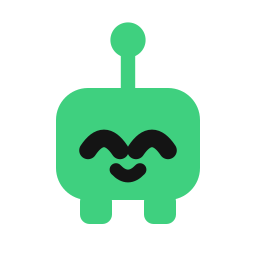
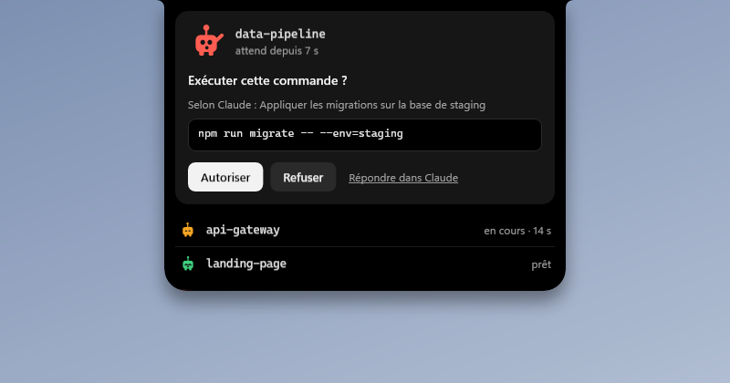
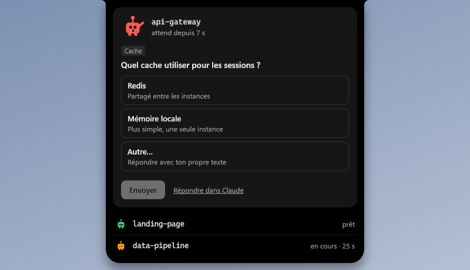
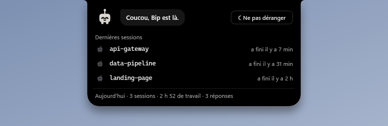
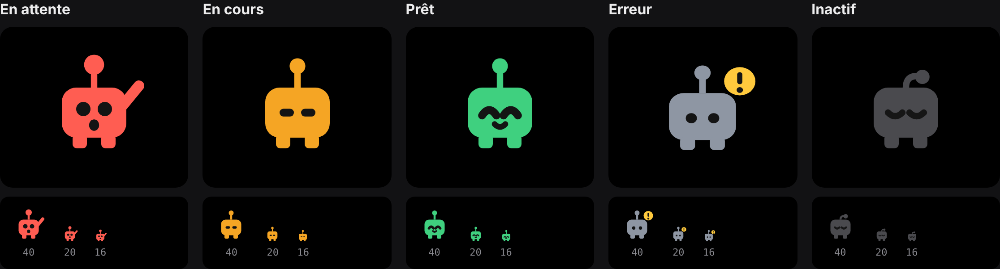
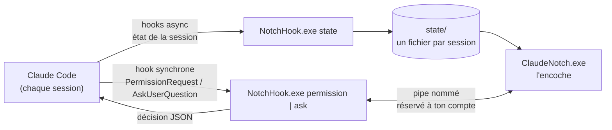

<div align="center">



# Bip

**L'encoche Claude Code pour Windows.**
Un petit robot par session, collé en haut de l'écran : tu vois d'un coup d'œil qui travaille,
qui a fini et qui t'attend, et tu réponds sans changer de fenêtre.




</div>

---

## Pourquoi

Claude Code travaille seul pendant de longues minutes, souvent dans plusieurs sessions à la fois.
Le problème n'est pas de le lancer, c'est de **savoir quand il a besoin de toi** : une commande
à autoriser, une question à trancher. Tant que personne ne répond, la session est bloquée.

Bip vit dans une encoche noire en haut au centre de l'écran, façon *Dynamic Island*. Repliée,
elle se fait oublier et laisse passer les clics ; au survol, elle se déplie et te laisse
répondre directement.

## Aperçu

| Repliée | Une demande arrive |
|:---:|:---:|
|  |  |
| Un Bip par session, dans l'ordre de lancement (5 au plus, puis « +N »). | L'encoche s'entrouvre 4 s pour dire qui attend, puis se replie ; un éclat rouge balaie son bord tant que la demande est ouverte. |

| Répondre à une question | Encoche vide |
|:---:|:---:|
|  |  |
| Choix unique, choix multiple ou réponse libre (« Autre… »). | Plus rien ne tourne : Bip se réveille, salue, montre les dernières sessions et le bilan du jour. |

## Bip



| État | Quand | Ce qu'il fait |
|---|---|---|
| **En attente** (rouge) | Une permission ou une question attend ta réponse | Lève le bras, respire de plus en plus vite, tremble de temps en temps |
| **En cours** (orange) | Claude réfléchit, lit, exécute | Flotte doucement |
| **Prêt** (vert) | Claude a fini et rend la main | Fait un petit saut, puis s'efface au bout de 4 min |
| **Erreur** (gris, « ! ») | Le tour s'est arrêté sur une erreur de l'API | S'affaisse |
| **Au repos** (gris foncé) | Session ouverte, rien demandé encore | Dort, antenne pliée |

Chaque état se lit aussi sans la couleur (bras, pastille, antenne), même à 16 px.
Le kit complet (SVG, PNG, valeurs de référence, aperçu animé) est dans [`design/bip-mascotte`](design/bip-mascotte).

## Fonctionnalités

- **Suivi en direct** de toutes les sessions Claude Code du poste (app desktop, terminal, IDE).
- **Permissions depuis l'encoche** : Autoriser, Refuser, ou « Toujours » avec la portée écrite
  sur le bouton (« Toujours : toutes les modifications de fichiers », « Toujours : Edit(src/\*\*) »…),
  limitée à la session. Jamais de « Toujours » pour les commandes shell.
- **Questions (AskUserQuestion)** : choix unique, multiple, plusieurs questions, réponse libre.
- **Répondre dans Claude** à tout moment : la demande repart dans la fenêtre habituelle.
- **Encoche vide** : Bip salue (et réagit si tu cliques dessus), dernières sessions terminées,
  bilan du jour (sessions, temps de travail, réponses). Un clic ailleurs ouvre Claude.
- **Ne pas déranger** pendant 1 h : ni entrouverture, ni éclat, ni clignotement.
- **Escalade douce** : après 5 min d'attente, la fenêtre Claude clignote dans la barre des
  tâches (désactivable). Jamais de mise au premier plan forcée, aucun son.
- **Invisible quand il le faut** : masquée pendant les applis en plein écran.

## Installation

Prérequis : Windows 10 ou 11 (le .NET Framework 4.x est déjà présent) et Claude Code.
Répondre aux questions depuis l'encoche demande Claude Code 2.1.85 ou plus récent.

```bat
git clone https://github.com/CR0ZER/bip.git
cd bip
installer.cmd
```

`installer.cmd` compile les deux exécutables si besoin, ajoute les hooks de Bip dans
`~/.claude/settings.json` (une sauvegarde datée est faite à côté), ajoute l'encoche au
démarrage de Windows et la lance. Il peut être relancé sans risque.

Pour tout retirer : `desinstaller.cmd`, puis supprimer le dossier. Seules les entrées de Bip
sont retirées de `settings.json` ; tes autres hooks ne sont pas touchés.

> Les nouvelles sessions Claude prennent les hooks en compte immédiatement ; une session déjà
> ouverte peut demander un redémarrage.

## Comment ça marche



- **L'état des sessions** passe par des hooks asynchrones : ils ne ralentissent jamais Claude.
  `NotchHook.exe` écrit `état|dossier|pid` dans `state\`, l'encoche relit ces fichiers.
- **Les réponses** passent par des hooks synchrones : le hook transmet la demande à l'encoche
  par un pipe nommé, attend ton clic, puis renvoie la décision à Claude Code.
- **Tout est compilé par le `csc.exe` livré avec Windows**, sans SDK : `build.cmd` suffit.

## Sécurité

- **Échec sûr** : encoche fermée, plantée ou injoignable, délai dépassé, demande illisible →
  le hook ne répond rien et Claude pose la question lui-même. **Jamais d'autorisation implicite.**
- **Pipe réservé** au compte Windows courant ; le hook vérifie que le serveur est bien le
  `ClaudeNotch.exe` installé à côté de lui avant d'envoyer quoi que ce soit.
- **Rien ne se valide au survol** : un clic complet est nécessaire, et les boutons ne s'arment
  qu'après 600 ms (ouverture, nouvelle carte ou liste qui bouge).
- **Ce que tu lis est ce qui sera exécuté** : commande toujours affichée en entier (avec le
  nombre de lignes si elle est longue), caractères invisibles ou d'inversion (U+202E…) rendus
  visibles, description de Claude présentée comme telle (« Selon Claude : … »).

## Performances

Mesuré sur un poste de travail, sur 20 s :

| Situation | Processeur | Mémoire |
|---|---|---|
| Une session au travail (Bip animé) | ~4,7 % d'un cœur | ~68 Mo |
| Aucun Bip animé | ~0,7 % d'un cœur | ~69 Mo |
| `NotchHook.exe`, par appel d'outil | ~70 ms, en arrière-plan | — |

Rendu logiciel, animations en boucle à 15–30 images/s, éclat seulement quand quelqu'un attend,
fenêtre à la taille de l'encoche. Le détail des mesures est dans [`docs/CONCEPTION.md`](docs/CONCEPTION.md).

## Structure

```
src/
  App.cs          point d'entrée, installation / désinstallation, appels Windows
  NotchWindow.cs  l'encoche : formes, transformations, cartes, encoche vide
  Bip.cs          la mascotte (portage C# du contrôle WPF du kit)
  Model.cs        sessions, journal du jour, demandes en attente, pipe nommé
  NotchHook.cs    le hook appelé par Claude Code
  Json.cs         lecture / écriture JSON
design/bip-mascotte/   kit de la mascotte (SVG, PNG, tokens.json, aperçu animé)
docs/                  journal de conception et captures
build.cmd · installer.cmd · desinstaller.cmd
```

**Diagnostic** : `ClaudeNotch.exe --dump-plan` affiche les sessions lues et ce que l'encoche
montrerait ; `notch.log` recueille les erreurs ; `journal\` garde 7 jours de bilan.

## Crédits

- **Inspiré de [coucou](https://github.com/Louis-CFM/coucou)** de Louis-CFM, l'encoche compagnon
  pour agents de code sur macOS (licence MIT). Bip en reprend l'idée (un bloc noir qui se
  transforme, des réponses depuis l'encoche) ; le code, la mascotte et le design sont propres
  à ce projet.
- **Mascotte et design** conçus avec Claude Design ; application développée avec Claude Code.
- Projet indépendant, non affilié à Anthropic. « Claude » et « Claude Code » sont des marques
  d'Anthropic.

## Licence

[MIT](LICENSE) © 2026 CR0ZER
